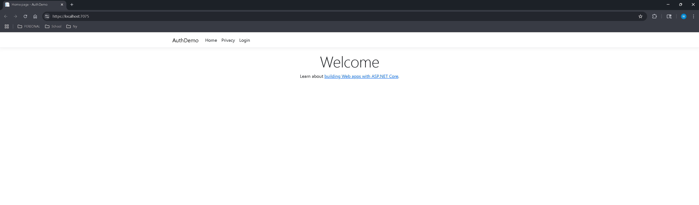
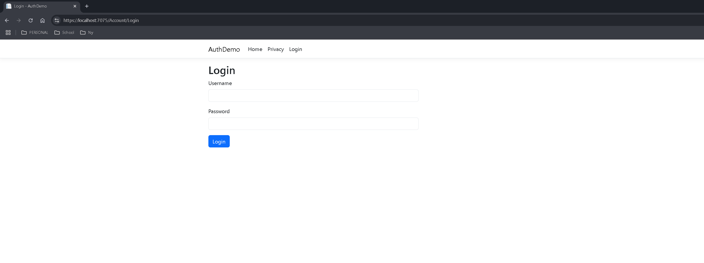
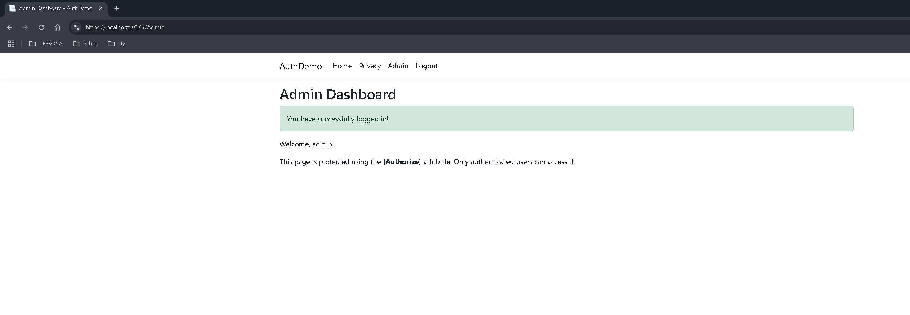
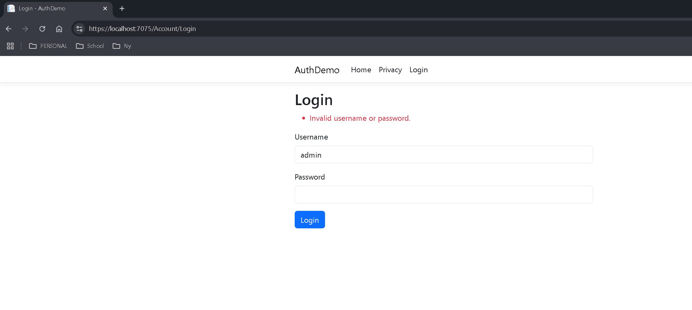

# AuthDemo
## Description
AuthDemo is an ASP.NET Core Razor Pages application that demonstrates
cookie-based authentication and authorization.

The application allows users to log in with their credentials, access a protected
Admin Dashboard, and securely log out.

## Features
- User credentials stored in data/users.json
- Passwords stored using ASP.NET Core password hashing
- Login form with credential validation
- Cookie-based authentication
- Admin Dashboard protected using [Authorize]
- Logout functionality that removes the authentication cookie
- Navigation that changes based on authentication status

## Login Credentials
Username: admin
Password: Password123!

These credentials are for demonstration purposes only.

## Screenshots
### Homepage

### Login Page

### Admin Dashboard

### Invalid Login

